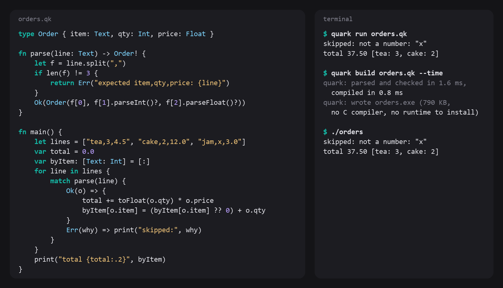

<div align="center">

<br>


<h1>quark</h1>

<p><b>Text and graph. Native code. Nothing else.</b></p>

<a href="https://github.com/eugeniobenfica/quark/releases/latest"></a>
<a href="LICENSE"></a>
<a href="#principles"></a>
<br>
<a href="https://github.com/eugeniobenfica/quark/actions/workflows/windows.yml"></a>
<a href="https://github.com/eugeniobenfica/quark/actions/workflows/linux.yml"></a>
<a href="https://github.com/eugeniobenfica/quark/actions/workflows/macos.yml"></a>
<a href="https://github.com/eugeniobenfica/quark/actions/workflows/checks.yml"></a>

<p>
<a href="#quick-start">Quick start</a> &nbsp;·&nbsp;
<a href="#download">Download</a> &nbsp;·&nbsp;
<a href="#building">Building</a> &nbsp;·&nbsp;
<a href="#documentation">Documentation</a> &nbsp;·&nbsp;
<a href="CHANGELOG.md">Changelog</a>
</p>

</div>

<br>

quark is a general-purpose compiled language whose programs are also node graphs. A program is written as text,
checked with inferred static types, and compiled straight to x86-64 or ARM64 machine code by a compiler written in
Quark itself, with no C compiler, linker or runtime to install. The same program can be turned into a graph of
nodes and back into text, so tools can read, edit, compare and merge it by node rather than by line.

> **Made for** programs that want to be fast and small without ceremony: command-line tools, servers, data
> processing, scripts embedded in a C or C++ application.<br>
> **Not** a garbage-collected VM, a JavaScript target or a 1.0 yet: the language is settling
> ([what stays stable](docs/STABILITY.md)), and no TLS for `https://` yet.

<div align="center">
<br>

<p><sub>A program, run, and built into an executable (<a href="docs/assets/src/hero.py">how this picture is made</a>).</sub></p>
</div>

## What is inside

| | |
| :--- | :--- |
| **Language** | Inferred static types, records, enums with data, exhaustive `match`, `T?` and `T!` instead of null and exceptions, generics, interfaces, closures, inferred effects |
| **Speed** | Native code from a quick tier (the compiler builds itself in about 2 s) and an optimizing one (`--release`: SSA, inlining, SIMD loops); faster than C on 4 of 8 benchmarks, within 11% on 2 more |
| **Memory** | An arena per call and a collection per loop: no garbage collector pauses, no reference counting, values that never change behind your back |
| **Concurrency** | Tasks (`go`, channels) that wait only on their own socket; `parallelMap` and `parallelFold` on every core |
| **C** | Calls C with no adapter (`extern fn`), C calls Quark, `quark bind` reads a C header; embeds in C and C++ as a library |
| **Graph** | `quark graph` writes a program as nodes (QGN or JSON), `quark text` writes it back, `quark diff` and `quark merge` work by node |
| **Tools** | `fmt` (one canonical layout), `test`, `lsp` (a language server), `dap` and `debug`, `doc`, `repl`, `bind`, `get` (packages) |
| **Library** | `json`, `http` (server and client), `net`, `files`, `csv`, `regex`, `time`, `math`, `collections`, `encoding`, `hash`, `args`, `path`, `testing` |

## Quick start

**1. Get the compiler** for your machine from the [latest release](https://github.com/eugeniobenfica/quark/releases/latest)
and put it on your `PATH` as `quark` (`quark.exe` on Windows).

**2. Write a program.**

```quark
// hello.qk
fn main() {
    let words = "the quick brown fox jumps over the lazy dog the end".words()
    let counts = words.countBy(w => w)
    print("{len(words)} words, 'the' {counts["the"] ?? 0} times")
}
```

**3. Run it, or build it.**

```bash
quark run hello.qk          # 11 words, 'the' 3 times
quark build hello.qk        # hello.exe (or ./hello): one file, nothing else to install
```

The [tour](docs/TUTORIAL.md) goes from here to a small HTTP server in ten steps.

## Platforms

| | Compiler and programs | Support |
| :--- | :--- | :---: |
| **Windows** x86-64 | PE executables, Windows 10 and 11 | Tier 1 |
| **Linux** x86-64 | ELF, glibc or musl | Tier 1 |
| **Linux** ARM64 | ELF, glibc or musl | Tier 1 |
| **macOS** Apple silicon, Intel | Mach-O, ad-hoc signed | Tier 1 |
| **Windows** ARM64 | PE | Tier 2 |
| **WebAssembly** | `quark build --target wasm32`: the language without the system | Tier 2 |

**Tier 1**: supported. Every change builds the compiler on it to the fixed point and runs the whole test suite
there, in CI.<br>
**Tier 2**: experimental. Built by `quark build --target` on every release, not yet run by any test.

## Download

| Platform | File |
| :--- | :--- |
| **Windows** x86-64 | [quark-x86_64-windows.exe](https://github.com/eugeniobenfica/quark/releases/latest/download/quark-x86_64-windows.exe) |
| **Windows** ARM64 | [quark-arm64-windows.exe](https://github.com/eugeniobenfica/quark/releases/latest/download/quark-arm64-windows.exe) |
| **Linux** x86-64 | [quark-x86_64-linux](https://github.com/eugeniobenfica/quark/releases/latest/download/quark-x86_64-linux) (glibc), [quark-x86_64-linux-musl](https://github.com/eugeniobenfica/quark/releases/latest/download/quark-x86_64-linux-musl) |
| **Linux** ARM64 | [quark-arm64-linux](https://github.com/eugeniobenfica/quark/releases/latest/download/quark-arm64-linux) (glibc), [quark-arm64-linux-musl](https://github.com/eugeniobenfica/quark/releases/latest/download/quark-arm64-linux-musl) |
| **macOS** | [quark-arm64-macos](https://github.com/eugeniobenfica/quark/releases/latest/download/quark-arm64-macos) (Apple silicon), [quark-x86_64-macos](https://github.com/eugeniobenfica/quark/releases/latest/download/quark-x86_64-macos) (Intel) |

Each is the whole compiler, standard library and runtime in one file. Checksums are in `SHA256SUMS`.

## Building

```bash
QUARK=path/to/quark ./build.sh --check
bash tests/run.sh build/quark.exe
```

Quark is built by a Quark compiler (a release's): it builds the compiler in `compiler/` once (stage 1), that one
builds it again (`build/quark.exe`), and `--check` has it build itself a third time and compares the bytes. With
`gcc` present it also links the C hosts the tests use. [Bootstrapping](docs/BOOTSTRAP.md) has the details.

<details>
<summary><b>What is where</b></summary>
<br>

```
compiler/            the compiler, in Quark: parser, checker, lowering, optimizer, x86-64 and ARM64 backends,
                     PE, ELF and Mach-O writers, the language server, the graph tools
compiler/runtime/    the runtime, in Quark: memory, texts, maps, tasks, threads, each system's calls
compiler/prelude.qk  the built-ins every program sees, written in Quark
std/                 the standard library
include/quark.h      the C API for hosts that embed Quark
tests/               the test suite (tests/run.sh), its programs and their expected output
examples/, bench/    example programs and the benchmarks against C
tools/               releases, benchmarks, libquark, the Linux VMs
docs/                the language, the tour, embedding, stability, memory, bootstrapping
```
</details>

## Quality

- **The compiler builds itself, to the same bytes.** Every change is checked by a three-stage bootstrap whose last
  two stages must be identical.
- **Nearly a thousand tests.** Programs and their exact output in both tiers, errors and their messages, panics,
  C calls in each calling convention, the graph's round trip, the language server, the debugger, the docs' examples.
- **Differential and fuzz testing.** Generated programs run in the quick tier, the optimizing tier and with and
  without AVX must agree; the parser, the formatter and the graph round trip are fed mutated programs on every change.

## Principles

- **No dependencies.** The compiler, the runtime and the library are written here, in Quark. The system's C
  library is the only thing a program calls that is not Quark.
- **One way to write each thing.** `quark fmt` writes the canonical layout, and the language has one form for each
  construct.
- **Text and graph are the same program.** Anything a program says survives the trip to a graph and back.
- **Fast by default.** Values are copied only when they must be, memory goes when a call or a loop's turn ends, and
  the common paths are measured against C.

## Documentation

| | |
| :--- | :--- |
| [A tour of Quark](docs/TUTORIAL.md) | From a first program to a server, in ten steps. |
| [The language](docs/LANGUAGE.md) | Everything: types, built-ins, the standard library, C, memory, tasks, the tools. |
| [Coming from Go, Rust or Python](docs/COMING-FROM.md) | What carries over, what does not, and the Quark way of each. |
| [Servers](docs/SERVERS.md) | Handlers, JSON, shared state, calling other services, tests, shipping. |
| [The prelude](docs/PRELUDE.md) | Every built-in the prelude declares, made by `quark doc` from its source. |
| [Embedding](docs/EMBEDDING.md) | Quark inside a C or C++ program: `quark.h` and libquark. |
| [Stability](docs/STABILITY.md) | What is promised to keep working, and how things change. |
| [Memory](docs/MEMORY.md) | The arena, the loops' collection, and why not reference counting. |
| [Bootstrapping](docs/BOOTSTRAP.md) | How the compiler builds itself. |
| [Relatório](docs/RELATORIO.md), [Plano](docs/PLANO.md) | The project's state and plan, in Portuguese. |

## License

MIT. See [LICENSE](LICENSE).

<div align="center">

<p><sub><b>Text and graph. Native code. Nothing else.</b></sub></p>
</div>
